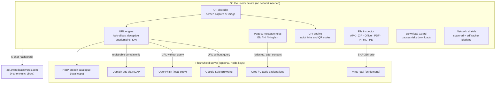

# PhishShield AI 0.2: features, and why it's not "just another phishing extension"

This document explains every feature added in 0.2, how each one works internally, where its code lives, and its limits. It is written so that anyone on the team can answer a judge's question about any part of the product.

Related reading:

- [HOW-IT-WORKS.md](HOW-IT-WORKS.md): the stack, architecture and AI integration.
- [research/VIRUSTOTAL.md](research/VIRUSTOTAL.md) and [research/HAVEIBEENPWNED.md](research/HAVEIBEENPWNED.md): what we learned from those services and what we adopted.
- [DEMO.md](DEMO.md): the stage demo script.

---

## 1. The edge, in one paragraph

Most anti-phishing extensions do one thing: they check the URL against a blocklist and show a red page. PhishShield is built around **how people in India actually get scammed today**:

- UPI "receive money" QR codes;
- fake KYC and e-challan **APK files** sent over WhatsApp;
- macro-laden "salary revision" documents;
- scam-ad redirect networks;
- breached-company impersonation calls.

It checks these **on the device**, explains *why* in English and Hindi, and never claims something is "safe" when it can only say "no known threats".

### The five pillars

| # | Pillar | What it means | Typical competitor |
| --- | --- | --- | --- |
| 1 | **India-first threat coverage** | UPI QR and `upi://` link analysis; scam-APK detection by name, permissions and source; Hindi and Hinglish scam language; Indian bank, government and delivery brands; 1930 / cybercrime.gov.in guidance | URL blocklist, English only |
| 2 | **Beyond the web page** | Files (APK, ZIP, Office, PDF, HTML, EXE), downloads in flight, QR codes on screen, pasted messages, leaked passwords | Web pages only |
| 3 | **Explainable evidence** | Every verdict comes with ranked reasons, raw evidence, which layer produced it (local, reputation, registry, AI), and what was *not* checked | "Dangerous site" with no reason |
| 4 | **Privacy by construction** | Files never uploaded (hash only). Passwords via k-anonymity. Only the registrable domain sent to registries. Feeds matched locally. No accounts or analytics. | Sends every URL, or uploads files to the cloud |
| 5 | **Honest verdicts** | Five verdicts. "Confirmed" only from verified intel (≥3 engines on VirusTotal, an exact list match). AI can raise concern but never confirm or clear. The score is labelled as not a probability. | Binary safe/unsafe, implied accuracy |

---

## 2. Feature map

Where each feature appears:

| Surface | Features |
| --- | --- |
| **Popup → This site** | Verdict, reasons, checks performed (now with **domain age** and **breach history**), page analysis, deep AI, and a "blocked on this page" count |
| **Popup → Scan link** | Manual URL scan, now a **deep scan** that also asks VirusTotal |
| **Popup → Check message** | Scam-tactic detection, link checks, **UPI links found in the message** |
| **Popup → Tools** (new) | **Scan a QR code on this screen**, shortcuts to the Security Center, and **Shields** toggles with per-page block counts |
| **Security Center** (new full page) | **Scan a file**, **QR & UPI image**, **Password check**, **Downloads** (recent Download Guard decisions) |
| **Download Guard page** (new) | Shown when a risky download is paused: cancel, delete, inspect, or (after "I understand the risk") continue |
| **Settings** | New "Downloads and ads" card, and privacy notes for every new data flow |

---

## 3. UPI and QR scam protection

**The scam.**

- "Scan this QR to receive your refund / cashback / prize / OLX payment."
- With UPI, **scanning a QR code and entering your PIN always sends money**. You never need a PIN to receive.
- Fraudsters also use "collect" requests, personal UPI IDs posing as businesses, and fake "KYC fee" payments.

### 3.1 How it works

**1. Getting the QR content** (`src/extension/lib/qr-decode.ts`):

- **Popup → Tools → Scan a QR code on this screen.** This uses `chrome.tabs.captureVisibleTab`, allowed by `activeTab` when you open the popup, so no extra permission is needed. The screenshot is decoded **in the popup** with **jsQR** (Apache-2.0) and then discarded.
- **Security Center → QR & UPI.** Upload a photo or screenshot, or paste the text.
- Decoding tries several scales (100%, 60%, 35%) and both normal and inverted colours, because phone photos and dark-mode screenshots often fail at a single scale.

**2. Routing the content** (`src/engine/qr.ts` → `analyzeQrPayload`):

- `upi://…` goes to the UPI engine.
- `http(s)://…` goes to the normal URL engine. The QR is never opened.
- `WIFI:…`, `BEGIN:VCARD`, or plain text are shown as information.

**3. UPI analysis** (`src/engine/upi.ts`):

- `parseUpi` reads `pa` (payee VPA), `pn` (name), `am` (amount), `cu`, `tn` (note) and `mode`/`purpose`, and detects mandates (autopay).
- `assessUpi` produces signals:

| Signal | Strength | Example |
| --- | --- | --- |
| `upi.receive_lure` | strong (0.6) | Note or name says "receive", "refund", "cashback", "prize", "won" (EN and HI) |
| `upi.fee_or_kyc` | moderate | "KYC", "registration fee", "processing charge", "police", "challan" |
| `upi.brand_personal_vpa` | moderate | Payee name says "SBI" / "Amazon" but the VPA is a personal ID like `98765…@ybl` |
| `upi.bill_personal_vpa` | moderate | An electricity or gas bill to a personal-looking VPA |
| `upi.mandate` | moderate | It sets up a recurring autopay, not a one-time payment |
| `upi.invalid_vpa` | moderate | A malformed UPI ID |
| `upi.unknown_handle` | contextual | A PSP handle not in our list of about 75 known handles |
| `upi.large_amount`, `upi.currency` | contextual / weak | ≥ ₹10,000 pre-filled for a non-merchant UPI ID; a non-INR currency |

**4. The result** always starts with a plain statement of what will happen: **"Scanning this QR sends money: ₹4,999 to Refund Desk (9876543210@ybl)"**. It also says what PhishShield can't know: who owns a VPA.

**Messages, too.** In **Check message**, any `upi://` links in pasted text are extracted and assessed the same way.

**Tests:** `tests/upi.test.ts`. **Verified in the browser** with real QR images generated for the test (a scam refund QR, a normal shop QR, a phishing-URL QR).

---

## 4. File scanning (Security Center → *Scan a file*)

**The scam.**

- "SBI_YONO_KYC_Update.apk", "RTO_E-Challan.apk" and "Wedding_Invitation.apk" are sent over WhatsApp. They request SMS and accessibility permissions and steal OTPs.
- "Invoice.pdf.exe" and `.lnk` shortcuts are hidden in ZIPs.
- HTML attachments are fake login pages.

### 4.1 How it works

1. **Reading the file.** You drop or choose a file. It is read with the File API **inside the extension page**. Nothing is uploaded, and the file is **never opened or run**.
2. **Inspection.** `inspectFile()` in `src/engine/file.ts` runs the static checks below. The full table, and how they compare to VirusTotal's tools, is in [research/VIRUSTOTAL.md §6](research/VIRUSTOTAL.md).
   - real type from magic bytes;
   - name tricks (RTLO, double extension, padding);
   - ZIP contents (including encrypted entries);
   - APK permissions and lure names;
   - Office macros;
   - PDF auto-run JavaScript and launch actions;
   - HTML login forms and smuggling;
   - Authenticode presence.
3. **Fingerprint.** SHA-256 is computed on-device.
4. **Hash lookup.** If **File fingerprint lookups** is on and a server is configured, only the hash goes to `POST /v1/file`. The server asks VirusTotal `GET /files/{sha256}`.
   - **≥3 engines flag it as malicious: Confirmed malicious**, with "41 of 64 engines" and a link to the VT report.
   - **1–2 engines:** a minority-detection signal, not confirmation.
   - **Not found:** "VirusTotal has never seen this file. That is not a clean result."
5. **Embedded links.** Links found inside PDFs and HTML files are each run through the URL engine and listed with their own verdict.
6. **Verdict.** Findings are combined by the same aggregator as web pages (`assessFile`), so the score, verdict, reasons and limitations are consistent everywhere.

### 4.2 Limits shown to the user

- Static checks only; nothing is ever executed.
- Up to 256 MB is inspected.
- Encrypted archives can't be looked into, but are flagged if they appear to contain programs.
- A clean result is not proof of safety.
- A valid signature is not proof of safety.

**Tests:** `tests/file.test.ts`, with synthetic ZIP, APK and PE fixtures built in `tests/helpers/zip.ts`. **Verified in the browser** with an HTML smuggling and login-form attachment, which gave **Likely dangerous, 75/100**, and with its embedded phishing link flagged.

---

## 5. Download Guard

**The problem.** People download first and think later. Once an APK is on the phone or an `.exe` is in Downloads, one tap is enough.

### 5.1 How it works

1. **Intercepting the download.** `chrome.downloads.onDeterminingFilename` fires for every download, before the file name is final. `src/extension/background.ts` → `guardDownload`.
2. **Never blocking Chrome.** We call `suggest()` straight away, then assess the download using **metadata only**:
   - file name;
   - MIME type;
   - source URL;
   - referrer page;
   - Chrome's own Safe Browsing danger flag.
3. **Assessment.** `assessDownload()` in `src/engine/download.ts`:

| Signal | When |
| --- | --- |
| `download.apk` / `download.apk_lure` | Android app from a website / with a KYC, challan, bill or invitation name |
| `download.program` / `program_lure` | `.exe`, `.msi`, `.scr`… / with a lure name |
| `download.script`, `download.shortcut`, `download.disk_image`, `download.macro_document` | `.ps1` / `.bat` / `.vbs` / `.js`, `.lnk`, `.iso` / `.img`, `.docm` / `.xlsm` |
| `download.mime_mismatch` | A "PDF" whose MIME type says it's an APK or a program |
| `download.built_in_page` | File built inside the page (`blob:` / `data:`), the HTML smuggling technique |
| `download.source_address` / `source_page` | The URL engine flags the download URL or the page that started it |
| `download.chrome_*` | Chrome's own danger verdict, repeated as threat intel |
| `file.double_extension`, `file.rtlo_name` | File-name tricks (shared with the file inspector) |

4. **Intervening.** When the verdict is **likely phishing**, or **suspicious *and* the file is runnable**, the download is **paused** (`chrome.downloads.pause`) and the **Download Guard page** opens.
   - **Cancel download** is the primary action.
   - **Delete file** is offered if the download finished first.
   - **Inspect the file in the Security Center.**
   - **Continue download (not recommended)** is disabled until you tick "I understand the risk".
5. **Ordinary downloads pass untouched.** Bank statements, photos, VLC from `videolan.org`, ZIPs of documents: these are in the tests. Trusted domains mute file-type warnings, but never Chrome's threat verdicts.
6. **History.** Decisions are kept in `chrome.storage.session` (memory only, at most 25 records) and listed in Security Center → Downloads.

**Why metadata only?** Reading a file's content would need `file://` access and would run while the download is still writing. The user can drop the saved file into the Security Center for a full inspection.

**Tests:** `tests/download.test.ts`. **Verified in the browser** with simulated Chrome download events:

- `RTO_E-Challan_2026.apk` from a WhatsApp referrer was paused, scoring 66.
- A photo download was allowed.
- Clicking Cancel called `downloads.cancel` and recorded "cancelled".

---

## 6. Network shields: scam-ad blocking and an optional ad and tracker blocker

**The problem.** A large share of "you won an iPhone", fake virus alerts and loan-app scams arrive through **pop-under and push-notification ad networks** on streaming and download sites.

### 6.1 How it works

- **Engine.** Uses Chrome's **declarativeNetRequest** (DNR), the MV3 blocking API. Chrome applies the rules itself, and the extension **never sees the requests**. That is better for privacy and performance than the old `webRequest` blocking.
- **Two static rulesets**, declared in `manifest.json` and stored in `src/extension/rules/`:

| Ruleset | Default | Contents |
| --- | --- | --- |
| `malvertising`: **Scam-ad shield** | **On** | 29 pop-under, push and redirect ad networks commonly abused for scams (PopAds, PropellerAds, Adsterra, Monetag, HilltopAds…) |
| `ads`: **Block ads and trackers** | Off | 82 mainstream ad, native-ad and tracking domains: DoubleClick, Google ad services, Amazon ads, Taboola (including `tblcontent.com`), Outbrain, Criteo, the big exchanges, Indian networks such as Colombia (`clmbtech.com`), iZooto push and AdRecover, and social-media ad pixels. Off by default because some sites break. |

- **Scope of each rule.** Every rule blocks only **third-party sub-resources** (`domainType: thirdParty`, all resource types except `main_frame`). So the shield never blocks a page you open on purpose, and never breaks a site's own content.
- **Toggles.** These live in Popup → Tools → Shields and in Settings. They call `declarativeNetRequest.updateEnabledRulesets`, which is re-synced on install, on browser start-up and on any settings change.
- **"Blocked on this page" counts** use `getMatchedRules({ tabId })`. This works for the active tab through `activeTab`, so the `declarativeNetRequestFeedback` permission isn't needed.

**Hide empty ad spaces** (opt-in, Settings). Blocking an ad request often leaves an empty box with an "Advertisement" label. When this is on, a small style sheet (`content/adhide.css`) collapses well-known ad containers: Google ad slots, Taboola, Outbrain and MGID widgets, AMP ads. It needs the optional "all sites" permission, which is the same one Credential Guard uses. That permission is requested when you turn the feature on and given back when neither feature needs it. The style sheet reads nothing on the page.

**Changes apply to new requests.** Ads already on a page stay until it reloads, so the popup shows **Reload this page to apply** after you flip a shield.

**Verified in real Chrome** (31 Oct 2026, ndtv.com):
- Requests to listed domains failed: DoubleClick, Taboola, PopAds, Adsterra.
- A request to an unlisted control loaded normally.
- No Google ad slots were created on the page.
- The remaining "Sponsored" widget came from `tblcontent.com`, which is now on the list.

**Honest positioning.** This is a focused, **curated** list, not EasyList. The goal is to block the networks that deliver scams with almost no breakage. DNR allows up to 30,000 static rules per extension, so converting a full community list is a straightforward next step (see §10).

**Tests:** the rule files are validated, as is the "never main_frame, always third-party" policy, the lists being disjoint, and the default states. **Verified in the browser:** toggling the ad blocker sent `enableRulesetIds: ["malvertising","ads"]`, and the block counts appeared in the popup.

---

## 7. Domain age (RDAP)

**Why it matters.** Most phishing domains are used within days of registration. "Registered 3 days ago" is one of the most useful signals there is, and most extensions don't show it.

### 7.1 How it works

**1. Finding the registry** (`src/server/intel/rdap.ts`):

- The server downloads the IANA RDAP bootstrap file (`https://data.iana.org/rdap/dns.json`). It maps each TLD to its official registry's RDAP server: Verisign for `.com`, NIXI for `.in`, and so on.
- RDAP is the modern, JSON-based replacement for WHOIS. It needs no API key.

**2. Sending the least data.** Only the **registrable domain** is sent, for example `example.co.in`, never the URL or subdomains.

**3. SSRF safety.**

- Registry base URLs must be `https://` on public hostnames.
- Redirects are followed manually, at most 2, and each is validated.
- 3.5 s timeout.
- Rate limit of 30 requests per minute per registry.

**4. Latency cap.** The reputation endpoint waits at most 2.5 s for RDAP. A slow registry finishes in the background and is cached for next time (24 h for found records). We saw this live: `example.com` timed out on the first request and was found on the second.

**5. Signals** (`src/engine/domain-age.ts`):

| Age | Signal | Strength |
| --- | --- | --- |
| < 7 days | `registry.domain_days_old` | moderate (0.26) |
| < 30 days | `registry.domain_weeks_old` | moderate (0.16) |
| < 90 days | `registry.domain_months_old` | contextual (0.06): only counts alongside a real indicator |
| older | informational | 0 |

Domain age **never flags a site by itself**. A brand-new domain with no other warning signs stays below *suspicious*. Combined with a brand look-alike, it pushes the result up.

**6. The UI.** The popup's **Checks performed** panel shows "Domain age: Registered 2005-03-03 (21 years ago)", with the registrar in the technical evidence. TLDs without RDAP are reported as such, not hidden; `.vn` is an example we saw live.

**Tests:** `tests/intel-extra.test.ts` (bootstrap parsing, unsafe bases, redirects, 404, timeouts) and `tests/upi.test.ts` (age bands). **Verified live:** `adobe.com`, `dominos.co.in` and `example.com`.

---

## 8. Breach history (HIBP)

The full design is in [research/HAVEIBEENPWNED.md §5.2](research/HAVEIBEENPWNED.md). In summary:

- The server downloads HIBP's public breach catalogue **daily** and matches it **locally**. We loaded 980 breaches live.
- The popup shows "dominos.co.in has had a data breach", with the date, accounts and data classes, plus HIBP attribution.
- It is **context, never a risk signal**. It helps people understand why a scam caller knows their address.

---

## 9. Password leak check (Security Center → *Password check*)

The full design is in [research/HAVEIBEENPWNED.md §5.1](research/HAVEIBEENPWNED.md). k-anonymity means only 5 hex characters of the SHA-1 hash leave the browser, and they go **directly** to HIBP, not through our server.

**Verified live:** `password` was found 52,372,427 times. The padding header works through CORS.

---

## 10. VirusTotal integration

The full design is in [research/VIRUSTOTAL.md](research/VIRUSTOTAL.md).

- **On demand only:** manual link scans (deep scan) and file hashes.
- **Lookup, never upload.**
- A **local quota limiter** (4/min, 500/day).
- A **3-engine confirmation threshold**.
- **"Never seen" is not "clean".**
- Set `VT_API_KEY` on the server. Without it, the UI says "Not configured".

---

## 11. Permissions (0.2)

| Permission | Why | Chrome install warning |
| --- | --- | --- |
| `storage` | Settings, trusted sites, per-tab state (session-only) | — |
| `webNavigation` | Check each top-level navigation before and as it loads | "Read your browsing history". We keep **no** history: per-tab results live in memory only. |
| `activeTab` + `scripting` | Read page text when you click *Analyze page*; capture the visible tab once for *Scan a QR code on this screen*; per-tab block counts | — |
| `downloads` | **Download Guard**: see new downloads, pause, cancel, or delete on your click | "Manage your downloads" |
| `declarativeNetRequest` | **Scam-ad shield** and **ad/tracker blocking**, applied by Chrome itself. The extension never sees your requests. | "Block content on any page" |
| `optional_host_permissions` (`http/https://*/*`) | **Credential Guard** only. Requested when you turn it on, removed when you turn it off. | Shown only at that moment |

We did **not** add:

- `declarativeNetRequestFeedback` (block counts work through `activeTab`);
- `<all_urls>` content scripts;
- `tabCapture`;
- `nativeMessaging`;
- `cookies`;
- `history`.

`tests/download.test.ts` pins the exact permission list, so an accidental extra permission fails the build.

---

## 12. Known limits and roadmap

| Area | Limit today | Next step |
| --- | --- | --- |
| Ad blocking | 111 curated domains, plus opt-in hiding of known ad containers; ads a site serves from its own domain can't be blocked | Convert EasyList / EasyPrivacy to DNR (up to 30k static rules) and add site-specific hiding rules |
| File inspection | Static, browser-side; APK manifest read by string search, not a full binary-XML parser | A full AXML parser; DEX string extraction for hard-coded SMS-forwarding numbers |
| Download Guard | Metadata only, Chromium only | Offer an automatic hash lookup of the finished file |
| UPI | Can't verify who owns a VPA | Integrate a merchant-verification source if one becomes available |
| QR | Visible part of the tab only | Region selection; scanning images on the page |
| Domain age | TLDs without RDAP (some ccTLDs) return "unsupported" | WHOIS fallback via a trusted provider |
| Accuracy | **No accuracy figure is claimed.** No labelled evaluation dataset yet. | Build a labelled set from OpenPhish and PhishTank plus a benign top-sites list, and report precision and recall per rule |
| Real Chrome | Download Guard is verified in real Chrome (a 3 MB APK paused at 90 KB, and Cancel removed it). Files of a few KB finish before they can be paused, so the guard page offers Delete for them. The DNR toggles and `captureVisibleTab` were verified only with a chrome.* stub and unit tests. | Run the full [demo script](DEMO.md) in Chrome |
