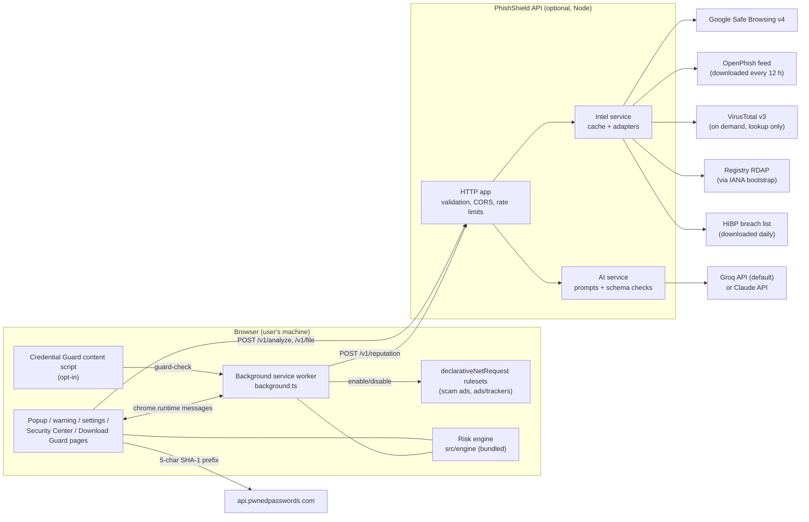
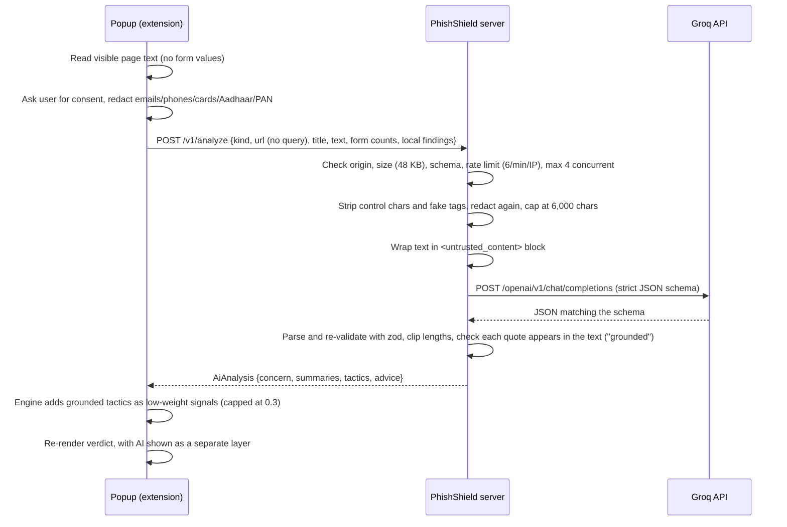

# How PhishShield AI works

This guide covers three things:

1. The technology stack and why each piece is there.
2. How the parts fit together, following one page visit from start to finish.
3. How to switch on the AI features, step by step, and what happens to the data when you do.

For setup basics and the privacy notice, see the [README](../README.md).

For every 0.2 feature in depth (UPI/QR, file scanning, Download Guard, ad blocking, domain age, breach history, password check), see [FEATURES.md](FEATURES.md). For the stage demo, see [DEMO.md](DEMO.md).

---

## 1. The big picture

PhishShield has three parts:

| Part | Where it runs | Needed? | Job |
| --- | --- | --- | --- |
| **Browser extension** | Chrome/Edge, on the user's machine | Yes | Watches navigation, shows the popup, warning page and settings. |
| **Risk engine** | Inside the extension (bundled into it) | Yes | Pure TypeScript that turns a URL, page text, file, download or UPI/QR payload into a verdict with evidence. No network access. |
| **API server** | Your laptop or a server you control | Optional | Holds the API keys. Looks URLs and file hashes up on threat lists, asks registries for domain age, keeps a local copy of the HIBP breach list, and calls an LLM (Groq by default) for AI analysis. |

**Without the server, PhishShield still works.** It runs in "local-only mode". These all happen on-device:

- URL and page checks;
- file inspection;
- QR and UPI analysis;
- Download Guard;
- ad blocking;
- the password check, which talks to HIBP directly.

The server adds things that need secrets, quotas or downloaded datasets:

- **Reputation:** Google Safe Browsing, OpenPhish (local copy), and VirusTotal (manual scans and file hashes only).
- **Registry and breach context:** domain age via RDAP, and HIBP's breach catalogue (local copy).
- **AI:** Groq's free API by default (`openai/gpt-oss-120b`), with Anthropic Claude as an optional alternative.



The key design rule is that **API keys live only on the server**. The extension knows nothing but the server's URL. The production build checks the extension bundle and refuses to finish if anything that looks like a key is in it.

---

## 2. The stack

### Shared

| Technology | Version | Used for | Why this choice |
| --- | --- | --- | --- |
| **TypeScript** (strict mode) | 6.0 | All code: extension, engine, server, tests | One language everywhere, so the risk engine is written once and used by the extension, the server and the tests. Strict typing catches mistakes at trust boundaries. |
| **zod** | 4.6 | Validating request bodies, provider responses and AI output | Anything that crosses a trust boundary is checked against a schema before use. The same schemas tell the AI model what JSON shape to return. |
| **tldts** | 7.4 | Splitting hostnames into subdomain / registrable domain / public suffix | Uses the Public Suffix List, so `sbi.co.in.secure-login.click` is correctly understood as belonging to `secure-login.click`. Hand-written parsing gets this wrong. |
| **punycode** | 2.3 | Decoding internationalised domains (`xn--pypal-4ve.com` → `pаypal.com`) | Needed to show users what an IDN really looks like and to detect look-alike characters. |
| **Web Crypto** (`crypto.subtle`) | built in | SHA-256 of files, SHA-1 for the password check | Native, fast, and available in both the browser and Node, so the same code is tested in Vitest. |

### Browser extension

| Technology | Used for | Notes |
| --- | --- | --- |
| **Chrome Manifest V3** | Extension platform | A background **service worker** (`background.ts`) instead of a persistent background page. State that must survive the worker being stopped lives in `chrome.storage.session`, which is memory-only and cleared when the browser closes. |
| **Plain TypeScript + DOM APIs** (no React or other framework) | Popup, warning page, settings page | Keeps the bundle small and loads instantly in a popup. A tiny helper (`ui/dom.ts`) builds elements safely, and ESLint forbids `innerHTML`, so page text can never inject HTML into the UI. |
| **CSS custom properties** | Theming | One set of design tokens (`ui/base.css`) with light and dark themes and a colour per verdict. |
| **`chrome.webNavigation`** | Seeing every top-level navigation | Lets the background check a URL before the page loads and again once it commits. |
| **`chrome.scripting` + `activeTab`** | Reading page text on demand | Runs only when the user clicks "Analyze page". |
| **Web Speech API** | "Listen" button | Reads the explanation aloud in English (en-IN) or Hindi (hi-IN). |
| **`chrome.downloads`** | Download Guard | `onDeterminingFilename` sees each download before its name is final. Risky ones are paused, and the decision page opens. |
| **`chrome.declarativeNetRequest`** | Scam-ad shield and ad/tracker blocking | Two static rulesets in `rules/`. Chrome applies them itself, so the extension never sees requests. `getMatchedRules` gives per-tab counts. |
| **`chrome.tabs.captureVisibleTab`** + **jsQR** 1.4.0 (Apache-2.0) | "Scan a QR code on this screen" | One screenshot via `activeTab`, decoded in the popup at several scales, then discarded. |
| **File API, `DecompressionStream`** | Security Center file scan | Reads files locally; inflates single ZIP entries (APK manifests, Office parts) without a ZIP library. |

### API server

| Technology | Used for | Why |
| --- | --- | --- |
| **Node.js 22** with the built-in `node:http` module (no Express) | HTTP server | Four endpoints don't need a framework, and fewer dependencies means a smaller attack surface. `--env-file-if-exists` loads `.env` without extra packages. |
| **Groq API** (OpenAI-compatible, called with `fetch`) | Default AI provider | Free tier is enough for demos and responses are fast. Strict JSON-schema output on `openai/gpt-oss-120b` means replies always have the shape we ask for. No SDK needed. |
| **@anthropic-ai/sdk** (1.3.0) | Optional AI provider (Claude) | Used only when `AI_PROVIDER=anthropic`. |
| **Google Safe Browsing v4 Lookup API** | URL reputation | Google's list of known phishing and malware URLs. Free for non-commercial use. |
| **OpenPhish community feed** | URL reputation | A plain-text list of active phishing URLs, downloaded every 12 hours and matched locally, so URLs are not sent to OpenPhish. |
| **VirusTotal API v3** | Multi-engine verdicts for URLs and file hashes | On demand only (free tier is 4 requests per minute). Lookup only, never upload. See [research/VIRUSTOTAL.md](research/VIRUSTOTAL.md). |
| **RDAP** (IANA bootstrap + registry servers) | Domain registration date | The modern, JSON replacement for WHOIS. No key. Only the registrable domain is sent. |
| **HIBP `/api/v3/breaches`** | Breach history per company domain | Downloaded daily and matched locally. CC BY 4.0. See [research/HAVEIBEENPWNED.md](research/HAVEIBEENPWNED.md). |

### Tooling

| Tool | Version | Used for |
| --- | --- | --- |
| **esbuild** | 0.28 | Bundling the extension (ES modules plus one IIFE content script) and the server. `scripts/build.mjs` also draws the PNG icons and runs the secret scan. |
| **Vitest** | 5.0 | 356 unit tests across the engine, file inspector, UPI, downloads, rulesets, intel adapters, AI validation and HTTP layer. |
| **ESLint + typescript-eslint** | 10 / 8.72 | Linting, including security rules (no `eval`, no `innerHTML`). |

There is **no database**. Caches are in memory: the server has a TTL cache, and the extension uses `chrome.storage.session`.

---

## 3. How it works, step by step

### 3.1 You open a link

1. **Before the page loads** (`webNavigation.onBeforeNavigate`), the background worker runs the risk engine on the URL, plus any reputation result already cached.
   - If the verdict is high-risk, it replaces the tab with the warning page straight away.
2. **When the page commits** (`onCommitted`), it does the full check:
   - It runs the local rules again and sets the toolbar badge.
   - If a server is configured, it sends the URL to `POST /v1/reputation`, with the query string and fragment removed and private/local addresses never sent.
   - It combines everything into the final verdict.
   - If that verdict is `likely_phishing` or `confirmed_malicious`, it shows the warning page.
   - Lower verdicts only change the badge colour.
3. **The result is stored per tab** in `chrome.storage.session`, so the popup can show it instantly.
   - Reputation results are cached for 30 minutes (clean) or 60 minutes (match).
   - Failures are cached for 60 seconds.
   - Cache keys are SHA-256 hashes of the URL, not the URL itself.

### 3.2 The risk engine (`src/engine/`)

The engine is a pure function: input in, verdict out, no network.

1. **Parse** (`url.ts`): normalise the URL, decode punycode, find the registrable domain with tldts, and detect IP hosts and private addresses.
2. **URL rules** (`url-rules.ts`): about 30 rules, each producing a **signal** with a weight between 0 and 1. Examples:
   - `sbi.co.in.secure-login.click` → *official domain embedded in a subdomain* (weight 0.6)
   - `paypa1.com` → *character substitution* (0.6)
   - `xn--pypal-4ve.com` → *IDN homoglyph* (0.65)
   - plain HTTP → *contextual* (0.04–0.12). Contextual signals only count when a real indicator is also present.
3. **Content rules** (`content.ts`, only after "Analyze page"):
   - English, Hindi and Hinglish patterns for OTP requests, KYC threats, digital arrest, electricity disconnection and similar scams.
   - Form checks, such as a password field on a page that uses a bank's name but isn't the bank's domain.
4. **Aggregate** (`aggregate.ts`):
   - **Score:** `score = 1 − Π(1 − weight)`, shown as 0–100. It is **not a probability**.
   - **`suspicious`** at 30 or above.
   - **`likely_phishing`** at 60 or above, and it also needs at least one strong signal or three moderate ones.
   - **`confirmed_malicious`** only when a reputation list matched the exact URL or a URL prefix.
   - **AI signals** are pooled and capped at 0.3 of weight in total.
   - **Every result also lists its limitations**, for example that only the URL was checked or that reputation lists were unreachable.
5. **Domain age** (`domain-age.ts`): if the server returned a registration date, a domain under 7 / 30 / 90 days old adds a moderate / moderate / contextual signal. It never flags a site on its own.

The same aggregator scores the other inputs, so every surface gives the same kind of verdict:

| Input | Engine file | Entry point |
| --- | --- | --- |
| A file | `file.ts` | `inspectFile()` → `assessFile()` |
| A download | `download.ts` | `assessDownload()` |
| A `upi://` link | `upi.ts` | `assessUpi()` |
| A QR code's text | `qr.ts` | `analyzeQrPayload()`, which routes to the UPI or URL engine |

### 3.3 You open the popup

The popup asks the background for the tab's stored result and renders:

- the verdict and risk meter
- the top reasons
- a "Checks performed" panel that keeps the three layers separate: **Local**, **Reputation** (per provider) and **AI**
- the expandable technical evidence

The other popup tabs:

- **Scan link:** the same engine plus reputation lookup, for a URL you paste.
- **Check message:** finds scam tactics in pasted SMS or WhatsApp text, scans every link in it, and assesses any `upi://` links.
- **Tools:**
  - **Scan a QR code on this screen**;
  - shortcuts to the Security Center;
  - **Shields** toggles, with "blocked on this page" counts.

### 3.4 The Security Center and Download Guard

- **Security Center** (`center/center.html`) is a full extension page. It needs the room, and a file picker would close the popup. It has four sections:
  - **Scan a file**
  - **QR & UPI** (image upload or pasted text)
  - **Password check**
  - **Downloads** (recent Download Guard decisions)
- **Download Guard.**
  1. The background worker sees each download in `chrome.downloads.onDeterminingFilename`, calls `suggest()` at once, and runs `assessDownload()` on the metadata.
  2. If the result is risky, it pauses the download and opens `download/download.html#<id>`.
  3. That page offers Cancel (primary), Delete (if already finished), Inspect, or Continue (after "I understand the risk").

Each feature is described in full in [FEATURES.md](FEATURES.md).

---

## 4. Integrating AI

### 4.1 What AI does, and what it is not allowed to do

AI is used in two places. Both are **on demand**: nothing is sent to an AI service while you browse.

| Feature | Where in the UI | Endpoint |
| --- | --- | --- |
| Deep AI analysis of the current page | Popup → *This site* → **Deep AI analysis** | `POST /v1/analyze` (`kind: "page"`) |
| AI explanation of a pasted message | Popup → *Check message* → **Explain with AI** | `POST /v1/analyze` (`kind: "message"`) |

The model's job is to **explain** scam tactics in plain English and Hindi, and to point to the exact sentence on the page that shows each tactic. It is deliberately limited:

- It **cannot mark a site as safe.** AI findings can only add risk, never remove it.
- It **cannot confirm a site as malicious.** Only reputation lists can do that.
- Its total influence on the score is **capped at 0.3**, and a finding only counts if its quote really appears in the page text.

These limits are what make AI safe to use on hostile content. A phishing page can try to talk the model into saying "this site is legitimate", but the verdict can't move in that direction.

The extension works fully **without** AI. Without a key, **Deep AI analysis** and **Explain with AI** show "not configured", and every local result is unchanged.

### 4.2 Which AI provider

| Provider | When to use | Model (default) | Key |
| --- | --- | --- | --- |
| **Groq** (default) | Demos and development: free tier, very fast responses | `openai/gpt-oss-120b` | `GROQ_API_KEY` from https://console.groq.com/keys |
| **Anthropic Claude** | Optional alternative, paid | `claude-opus-5-5` | `ANTHROPIC_API_KEY` |

The server picks the provider like this:

- **`AI_PROVIDER=groq` or `AI_PROVIDER=anthropic`** forces that provider.
- **`AI_PROVIDER=none`** turns AI off.
- **If `AI_PROVIDER` is empty,** the server uses Groq when `GROQ_API_KEY` is set, otherwise Claude when `ANTHROPIC_API_KEY` is set.

Both providers sit behind the same small interface, so the rest of the system doesn't know or care which one is used.

**Groq free-tier limits.** The free tier allows about **30 requests and 8,000 tokens per minute** on the gpt-oss models; your exact limits are on the Groq console's limits page. One Deep AI analysis uses roughly 3,000–5,000 tokens. PhishShield therefore sends at most 6,000 characters of page text to Groq and caps the answer at 2,048 tokens. Expect one or two analyses per minute. If you go faster:

- The popup shows "AI provider rate limit reached; try again in N s".
- Local results stay valid.

### 4.3 Turn it on (about 5 minutes)

Commands are for **PowerShell** on Windows. On macOS/Linux, use `cp` instead of `Copy-Item`.

**Step 1: Get a free Groq key.** Sign in at https://console.groq.com, open **API Keys** and create a key (it starts with `gsk_`). Keep it secret: it goes only in the server's `.env` file, which is in `.gitignore`. The extension never sees it, and the build fails if a key-like string ends up in the extension bundle.

**Step 2: Create the `.env` file** in the project root:

```powershell
Copy-Item .env.example .env
```

Open `.env` and set:

```ini
GROQ_API_KEY=gsk_...your key...
```

That's the only required line. `GROQ_MODEL` defaults to `openai/gpt-oss-120b`. `GSB_API_KEY` is optional and separate, and OpenPhish works without any key.

**Step 3: Build and start the server.**

```powershell
npm run build
```

```powershell
npm run server
```

You should see:

```
[phishshield] API listening on http://127.0.0.1:8787
[phishshield] Google Safe Browsing: not configured (set GSB_API_KEY)
[phishshield] OpenPhish feed: enabled
[phishshield] VirusTotal: not configured (set VT_API_KEY)
[phishshield] Domain age (RDAP): enabled · HIBP breach catalogue: enabled
[phishshield] AI analysis: Groq openai/gpt-oss-120b
```

If the last line says `not configured (set GROQ_API_KEY)`, the server didn't find your key. Check that `.env` is in the project root (next to `package.json`) and that the line reads `GROQ_API_KEY=gsk_...`.

**Step 4: Test the AI directly**, before involving the extension. Open a second PowerShell window:

```powershell
$body = @{ kind = 'message'; text = 'Dear customer, your SBI account will be blocked today. Update KYC now and share the OTP sent to your mobile.' } | ConvertTo-Json
Invoke-RestMethod -Method Post -Uri http://127.0.0.1:8787/v1/analyze -ContentType 'application/json' -Body $body | ConvertTo-Json -Depth 5
```

A working setup returns something like this (the wording will vary):

```json
{
  "status": "ok",
  "provider": "Groq",
  "model": "openai/gpt-oss-120b",
  "concern": "high",
  "summaryEn": "This message threatens to block your account and asks for your OTP...",
  "summaryHi": "यह संदेश आपका खाता बंद करने की धमकी देता है...",
  "tactics": [
    { "tactic": "otp_or_pin_request", "evidenceQuote": "share the OTP sent to your mobile", "grounded": true, "explanation": "..." }
  ],
  "advice": ["Never share an OTP...", "Report at cybercrime.gov.in or call 1930"]
}
```

If you get `"status": "unavailable"`, the key isn't loaded. For other statuses, see the troubleshooting table in section 4.7.

**Step 5: Connect the extension.**

1. Build and load `dist/extension` (**Load unpacked** on `chrome://extensions`).
2. Open PhishShield's **Settings** and keep the server URL as `http://localhost:8787`.
3. Click **Test**. The result should include `AI analysis: Groq (openai/gpt-oss-120b)`.
4. Visit any page, open the popup, and click **Deep AI analysis**.
5. The privacy prompt names Groq as the provider the text goes to. Accept it, and the AI result appears in its own dashed block labelled as model-generated.

### 4.4 What happens during an AI request



The files involved:

| File | What it does |
| --- | --- |
| `src/extension/popup/popup.ts` → `deepAi()` | Consent, page capture, redaction, calls the API, and folds the result into the assessment. |
| `src/extension/lib/api.ts` | `fetch` wrapper with timeouts (45 s for analysis) and response validation. |
| `src/server/app.ts` | HTTP routes, request schemas, CORS, rate limits. |
| `src/server/ai/service.ts` | Provider-independent logic: builds prompts, calls the provider, validates the result. |
| `src/server/ai/prompt.ts` | System prompts and the code that builds the user prompt from untrusted text. **Edit here to change what the model is told.** |
| `src/server/ai/schema.ts` | The JSON shape the model must return, plus the post-checks (grounding, length limits). |
| `src/server/ai/types.ts` | The `ModelClient` interface every provider implements. |
| `src/server/ai/groq.ts` | The Groq client. The only file that talks to Groq. |
| `src/server/ai/anthropic.ts` | The optional Claude client. |
| `src/server/index.ts` → `createModelClient()` | Picks the provider from the config. |
| `src/engine/index.ts` → `aiSignals()` | Turns AI tactics into signals. Only grounded quotes get weight. |

### 4.5 The Groq call

Groq's API is OpenAI-compatible, so PhishShield calls it with plain `fetch`. No extra SDK is needed. This is the request `src/server/ai/groq.ts` sends for a page analysis:

```ts
await fetch('https://api.groq.com/openai/v1/chat/completions', {
  method: 'POST',
  headers: { authorization: `Bearer ${GROQ_API_KEY}`, 'content-type': 'application/json' },
  signal: AbortSignal.timeout(30_000),
  body: JSON.stringify({
    model: 'openai/gpt-oss-120b',
    messages: [
      { role: 'system', content: ANALYSIS_SYSTEM_PROMPT },
      { role: 'user', content: userPrompt },            // page text inside <untrusted_content>
    ],
    max_completion_tokens: 2048,
    temperature: 0.2,
    response_format: {
      type: 'json_schema',
      json_schema: { name: 'phishshield_analysis', strict: true, schema: z.toJSONSchema(ModelAnalysisSchema) },
    },
    reasoning_effort: 'low',                             // gpt-oss is a reasoning model; keep it quick
    include_reasoning: false,                            // we only want the JSON answer
  }),
});
```

Points worth knowing:

- **Strict structured output.** With `strict: true`, Groq constrains the model to the JSON schema, so the reply always has the right shape. The schema comes straight from the zod definition in `schema.ts`, so there is one source of truth.
- **Other models still work.** Models without strict-schema support (for example `llama-3.3-70b-versatile`) automatically use JSON-object mode, with the schema described in the system prompt.
- **Nothing is trusted blindly.** The server always parses and re-validates the reply with zod, then checks every quote against the page text.
- **Reasoning settings.** `reasoning_effort` and `include_reasoning` are sent only to gpt-oss models. If Groq ever rejects them for a model, the client retries once without them.
- **Errors never crash a request.** Each failure maps to a clear status:
  - HTTP 401/403 → credential error
  - 429 → `rate_limited`, including Groq's `retry-after` seconds
  - 413 → request too large
  - 498/5xx → provider busy
  - timeout → `timeout`
  - a reply cut off by the token limit → truncated

  Groq's own error text is never shown to users or logged.

### 4.6 Customising the AI

| You want to… | Change |
| --- | --- |
| Use a different Groq model | Set `GROQ_MODEL` in `.env`, e.g. `openai/gpt-oss-20b` (smaller and faster), then restart. Run the Step 4 test once to check it. |
| Switch to Claude | Set `ANTHROPIC_API_KEY` and `AI_PROVIDER=anthropic`, then restart. |
| Allow longer AI calls | `AI_TIMEOUT_MS` in `.env` (default 30000). The extension waits up to 45 s. |
| Send more or less page text | `MAX_INPUT_CHARS` in `groq.ts` (6,000). Keep it low on the free tier, because tokens per minute is the tightest limit. |
| Change the model's instructions or tone | `ANALYSIS_SYSTEM_PROMPT` in `src/server/ai/prompt.ts`. Keep the rules about untrusted content and "never say a site is safe". |
| Add a new output field (e.g. a risk category) | (1) add it to `ModelAnalysisSchema` in `schema.ts`; (2) copy it across in `validateAnalysis`; (3) add it to `AiAnalysis` in `src/shared/types.ts`; (4) display it in `aiBlock()` in `src/extension/ui/render.ts`; (5) add a test in `tests/ai.test.ts`. For strict mode, new fields must be required. Use `.nullable()` for "optional" values. |
| Add a new tactic type | Add it to `AI_TACTICS` in `src/shared/types.ts`. The schema enum and the UI label pick it up automatically. |
| Add another provider | Write a `ModelClient` (see `types.ts`), modelled on `groq.ts`. Add it to `createModelClient()` in `src/server/index.ts` and to `AiProviderId` / `resolveAiProvider` in `config.ts`. |
| Change how much AI affects the score | `AI_WEIGHT_CAP` in `src/engine/aggregate.ts` and the base weights in `aiSignals()`. Keep the cap low: AI explains, it doesn't decide. |

After any change, run:

```powershell
npm run check
```

That runs typecheck, lint, tests and build together. The AI tests use a fake `fetch` and a fake model client, so they need no key and make no network calls.

### 4.7 Troubleshooting

| Symptom | Cause | Fix |
| --- | --- | --- |
| `AI analysis: not configured (set GROQ_API_KEY)` in the server log | `.env` not found or key empty | Put `.env` next to `package.json` and restart with `npm run server`. |
| `"The AI provider rejected the server credentials."` | Invalid or revoked key | Create a new key at https://console.groq.com/keys. |
| `"status": "rate_limited"` | Groq free-tier limit (requests or tokens per minute, or the daily cap) | Wait the number of seconds shown. For a live demo, leave about 30 seconds between Deep AI analyses. |
| HTTP 429 from PhishShield itself | PhishShield's own limit of 6 analyses per minute per client | Wait a minute. |
| `"The request was too large for the AI provider's limits."` | Page text plus answer exceeded the per-minute token budget | Lower `MAX_INPUT_CHARS` in `groq.ts`, or switch to `openai/gpt-oss-20b`. |
| `"The AI provider is busy or unavailable (503)."` | Groq overloaded or under maintenance | Try again shortly. Local results are unaffected. |
| `"The AI response did not match the required format."` | The model returned malformed JSON (most likely with a non-strict model) | Use `openai/gpt-oss-120b` or `openai/gpt-oss-20b`, which support strict mode. |
| Extension says the server isn't reachable | Server not running, or wrong URL in Settings | Start the server and use `http://localhost:8787`. Remote servers must use `https://`. |
| HTTP 403 from the server | Request came from a non-extension origin | Expected for websites. For a deployed server, set `ALLOWED_ORIGINS=chrome-extension://<id>` using the ID shown on `chrome://extensions`. |

### 4.8 Running it for a demo or deployment

- **Hackathon demo:**
  - Run the server on the same laptop as the browser. `localhost` over HTTP is allowed and nothing else is needed.
  - Do one test analysis before going on stage, so you know the key works.
  - Leave about 30 seconds between Deep AI analyses so you stay inside the free-tier limits.
- **Shared deployment:**
  - Run the server behind HTTPS, for example on a small VM or container behind a reverse proxy.
  - Set `HOST=0.0.0.0` and `ALLOWED_ORIGINS=chrome-extension://<your-extension-id>`.
  - Store keys in the host's secret manager, not in the repo.
  - The server's rate limits are per IP and in memory, which is fine for one instance.
  - For real users, move to a paid Groq tier or Claude, because the free tier's per-minute limits are shared by everyone using your server.
- **Data:** the PhishShield server doesn't store or log page text. The AI provider processes it under its own API data policy, so check Groq's terms before using real user data.

---

## 5. Where things live

```
src/
  engine/            Risk engine (pure, no network). Shared by extension and tests
    url.ts             URL parsing and normalisation
    url-rules.ts       Deceptive-URL rules
    brands.ts          Brand catalogue (official domains, names in English and Hindi)
    lookalike.ts       Homoglyph skeletons, edit distance
    content.ts         Page and message text rules (EN / HI / Hinglish)
    aggregate.ts       Scoring, verdicts, limitations, VirusTotal minority detections
    domain-age.ts      Registration-age signals
    file.ts            Static file inspector (type, ZIP, APK, Office, PDF, HTML, PE) and assessFile()
    download.ts        Download Guard assessment
    upi.ts             UPI link parsing and scam rules
    qr.ts              QR payload routing (UPI / URL / Wi-Fi / contact / text)
  shared/            Types, redaction, Pwned Passwords k-anonymity client
  extension/
    manifest.json      MV3 manifest (permissions)
    background.ts      Navigation checks, warnings, badges, message router
    popup/             Popup UI (4 tabs: This site, Scan link, Check message, Tools)
    warning/           Full-page warning
    center/            Security Center (file, QR/UPI, password, downloads)
    download/          Download Guard decision page
    rules/             declarativeNetRequest rulesets (malvertising on, ads off)
    options/           Settings and privacy notice
    content/           Page-text extractor and Credential Guard
    lib/               API client, settings, session state, messaging, QR decoding
    ui/                DOM helpers, rendering, i18n, CSS
  server/
    index.ts           Wires everything together and starts HTTP
    app.ts             Routes, validation, CORS, rate limits
    config.ts          Reads .env
    intel/             Safe Browsing, OpenPhish, VirusTotal, RDAP and HIBP adapters, cache service
    ai/                AI service, Groq and Claude clients, prompts, output schema and checks
tests/               Vitest suites
demo/                Harmless sample QR codes and files for the demo
scripts/build.mjs    Build, icons, secret scan
```
