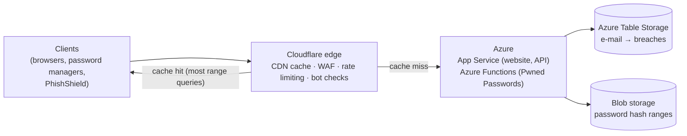
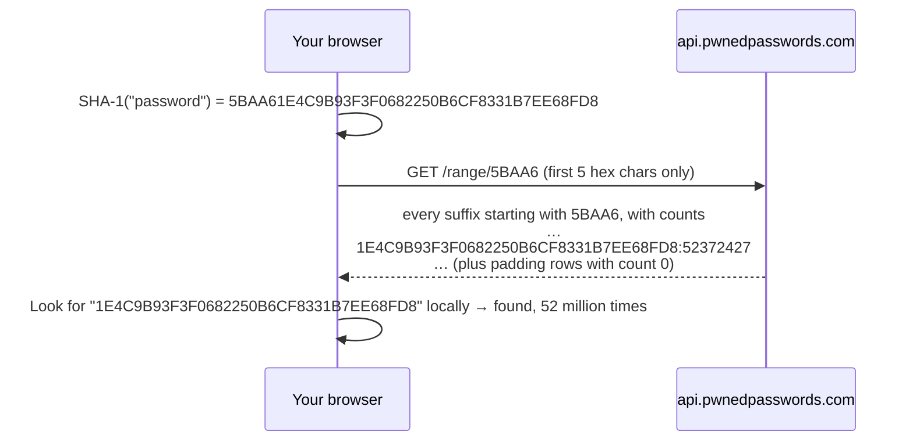

# Have I Been Pwned: how it works, and what PhishShield took from it

Our mentors asked us to study Have I Been Pwned (HIBP) as well. This document covers:

- what the service does and how its backend is built (from its creator's public write-ups);
- its APIs and terms;
- the privacy technique that makes it special (**k-anonymity**);
- what we built into PhishShield as a result.

> Architecture details come from Troy Hunt's blog posts and conference talks about the service. Specific figures (request counts, cache hit rates) are as reported at the time of those posts and will have changed since.

---

## 1. What HIBP is

HIBP is a free service run by Australian security researcher **Troy Hunt**, launched in December 2013 after the Adobe breach. It collects data from breaches that have been made public and answers two questions:

1. **"Is my e-mail address in a breach?"**
   - Lists which breaches it appears in (Adobe 2013, LinkedIn 2012, Domino's India 2021…).
   - Says which kinds of data leaked: passwords, phone numbers, addresses.
2. **"Has this password appeared in a breach?"**
   - Answered by **Pwned Passwords**, a corpus of real passwords exposed in breaches.
   - It numbers in the hundreds of millions, and grows as law enforcement (FBI, UK NCA) and new breaches feed it.

**Who uses it.** Password managers (1Password and others), browsers (Mozilla Monitor) and many sign-up forms check passwords against Pwned Passwords. Governments use it to monitor their own domains.

---

## 2. How the backend is built

The striking thing about HIBP is that **one person runs a service handling billions of requests a month on a very small budget**. The architecture is built around that constraint.



### 2.1 Azure for compute and storage

**Hosting.** The site and API run on Microsoft Azure: App Service for the web app and API, and **Azure Functions** for Pwned Passwords.

**Breached e-mail lookups use Azure Table Storage**, a cheap key-value store.

- In early posts Hunt explains the key choice. Partition key = the e-mail's domain; row key = the part before the `@`.
- So a lookup is one direct key read, not a search.
- That is why it stays fast across billions of rows.

**Pwned Passwords.** Hunt has written that he first reached for Table Storage out of habit, and then found that **serving precomputed range files** was the better fit.

### 2.2 Cloudflare in front, doing most of the work

All traffic goes through **Cloudflare**, which handles:

- **caching**: the big one, see §3;
- **firewall rules and rate limiting**, to protect the API from abuse;
- **bot challenges** on the website's search box, so the paid API is the only way to search in bulk.

A conference talk about the service reports that Cloudflare's caching cut its potential cost by over 90%. In 2018, Hunt reported that 47% of Pwned Passwords requests were already served from Cloudflare's cache without reaching Azure. The design of the range API (§3) is what makes this caching possible.

### 2.3 Breach loading

Breaches arrive from many sources: researchers, journalists, sometimes the breached company itself.

**Verification.** Each one is verified before loading. For example, Hunt checks whether e-mails in it exist on the claimed site, and whether people in it confirm the data. Then it gets a record in the breach catalogue (§4.2).

**Data is classified:**

| Flag | Meaning |
| --- | --- |
| `IsVerified` | Confirmed real |
| `IsFabricated` | The data is real e-mails but probably not from the claimed site |
| `IsSpamList` | A spam list, not a security breach |
| `IsSensitive` | e.g. an adult site; not shown in public e-mail searches |
| `IsRetired` | Permanently removed |
| `IsMalware`, `IsStealerLog` | From infostealer malware rather than a breached service |

**Hunt does not keep passwords linked to e-mails.** Passwords go into Pwned Passwords as hashes, separate from e-mail data.

---

## 3. Pwned Passwords and k-anonymity: the key idea

### 3.1 The problem

A website that checks passwords against a breach list would need to be told the password. Sending passwords to a third party is exactly what users should never do.

Even sending a full SHA-1 hash is unsafe. Common passwords' hashes are well known, so the server would learn the password.

### 3.2 The solution: the range query (k-anonymity)

This model was developed with **Junade Ali at Cloudflare** and launched with Pwned Passwords v2 in February 2018. On 1 June 2018 HIBP retired the old endpoints that accepted a password or a full hash.



- **5 hex characters give 16⁵ = 1,048,576 buckets.** Each bucket holds every leaked password hash that starts with those characters. When we tested, the `5BAA6` bucket returned 2,139 rows.
- **The server learns only the bucket.** It can't tell which of the thousands of hashes, or any password not in the list, you were checking. That is *k-anonymity*: your query hides among at least *k* others.
- **Padding (`Add-Padding: true`)** adds fake rows with count `0`. Then the size of the HTTPS response doesn't reveal which bucket was asked for. The client ignores count-0 rows. We tested live on 31 Oct 2026: the header works from an extension page through CORS, and the response included 161 zero-count rows.
- **It makes caching nearly perfect.** There are only about a million possible URLs, and the responses are the same for everyone, so Cloudflare can cache them all. Privacy and cost-efficiency come from the same design decision.
- **No API key, no rate limit, no attribution required** for Pwned Passwords (per the official API docs).

There is also an NTLM mode (`?mode=ntlm`) for Windows password audits. HIBP applies the same range idea to e-mail hashes for enterprise partners. For example, Mozilla Monitor checks e-mail addresses without sending them.

---

## 4. The API (v3)

All requests need a **descriptive `User-Agent` header**. A missing one returns HTTP 403.

### 4.1 Endpoints

| Endpoint | Key needed? | What it returns | PhishShield |
| --- | --- | --- | --- |
| `GET https://api.pwnedpasswords.com/range/{5 hex}` | **No** (no rate limit) | Hash suffixes and counts | **Yes**: password check, directly from the browser |
| `GET /api/v3/breaches` | No | The whole public breach catalogue (~1,000 records) | **Yes**: downloaded daily by the server, matched locally |
| `GET /api/v3/breach/{name}` | No | One breach | No (we already have the catalogue) |
| `GET /api/v3/dataclasses`, `/latestbreach` | No | Reference data | No |
| `GET /api/v3/breachedaccount/{email}` | **Yes, paid** (`hibp-api-key`) | Breaches for an e-mail | **No**: needs a paid key, and sending e-mails to a third party conflicts with our privacy rules |
| `GET /api/v3/pasteaccount/{email}` | Yes, paid | Pastes for an e-mail | No |
| Domain search, stealer-log endpoints | Yes, plus domain ownership verification | Breached accounts on a domain you own | No |

### 4.2 The breach record

```json
{
  "Name": "DominosIndia", "Title": "Domino's India", "Domain": "dominos.co.in",
  "BreachDate": "2021-03-24", "AddedDate": "...", "PwnCount": 22527655,
  "DataClasses": ["Email addresses", "Names", "Phone numbers", "Physical addresses", "Purchases"],
  "IsVerified": true, "IsFabricated": false, "IsSensitive": false, "IsRetired": false, "IsSpamList": false, "IsMalware": false
}
```

This is real data. PhishShield's server returned exactly this record when we checked `https://dominos.co.in/` on 31 Oct 2026.

### 4.3 Terms

- **The HIBP API data is licensed under Creative Commons Attribution 4.0.** You must name HIBP as the source, with a visible link, wherever the data is shown.
  - PhishShield shows "Source: Have I Been Pwned (CC BY 4.0)" under every breach block.
  - The health endpoint reports the licence as well.
- **No attribution is required for Pwned Passwords.**
- **Breach, paste and stealer-log endpoints are rate limited** according to the key you buy. A 429 response includes `retry-after`.

---

## 5. What PhishShield adopted

### 5.1 Password leak check (Security Center → *Password check*)

`src/shared/pwned.ts` and `src/extension/center/center.ts` implement the protocol from §3:

1. SHA-1 is computed **in the browser** with Web Crypto.
2. **Only the 5-character prefix** goes to `api.pwnedpasswords.com`, **directly from the extension page**. Not through the PhishShield server, so our server never sees even the prefix.
3. The request is sent with `Add-Padding: true` and `credentials: 'omit'`. If a network or CORS error happens, it retries once without the padding header.
4. The suffix is matched locally. Count-0 padding rows are ignored.
5. The input box is **cleared when you press Check**. Nothing is stored. The check runs only on click, never while typing.
6. The page shows the user exactly what was sent: "Only '5BAA6' (the first 5 of 40 characters of the password's SHA-1 hash) was sent."

Tests in `tests/pwned.test.ts` cover:

- that only the prefix and the padding header are sent;
- that count-0 rows are ignored;
- the fallback when the padding request fails;
- error handling.

### 5.2 Breach history as context, never as a signal

**The idea.** Scammers use leaked data to make calls and messages believable: "Hello, I'm calling from Domino's about your order to [your real address]". If someone is on a site whose company was breached, it helps them to know which data leaked.

**How it is built** (`src/server/intel/hibp.ts`):

- The server downloads `/api/v3/breaches` **once a day**, with a proper User-Agent, and indexes it by domain.
- **Entries flagged fabricated, spam list or retired are skipped.** Those would wrongly tie a company to a breach.
- At most 5 breaches per domain are kept, newest first.
- **Lookups are local.** No request goes to HIBP per page, so HIBP never learns which sites our users visit. This is the same pattern we use for the OpenPhish feed.
- The popup shows a **Breach history** block: breach name, month, number of accounts and data classes, plus the attribution.

**Why it is not a risk signal.** A breach says nothing about whether *this page* is fake. `www.adobe.com` is the real Adobe even though Adobe was breached in 2013. So breach data **never changes the score or verdict**, and the UI says so: "This does not mean this page is fake."

### 5.3 Design lessons we applied across PhishShield

| HIBP lesson | Where we applied it |
| --- | --- |
| **Send the least data that still answers the question** (k-anonymity) | Passwords: 5-char hash prefix. Files: SHA-256 only, never content (VirusTotal). RDAP domain age: only the registrable domain, never the URL. Reputation: URL without query string. |
| **Download the dataset and match locally instead of sending each query** | OpenPhish feed (every 12 h), HIBP breach catalogue (daily). |
| **Cacheable, deterministic responses** | Server TTL caches for reputation, RDAP (24 h for found records) and VT (with quota-aware caching). |
| **Rate-limit at the edge** | Per-IP rate limits on every server endpoint, a local VT quota limiter, and a per-registry RDAP limiter. |
| **Classify data quality** (verified, fabricated, spam) | Skipping fabricated, spam and retired breaches; separating "confirmed" (verified intel) from "likely" (heuristics). |
| **Be transparent about what was sent** | Every result lists what was and wasn't checked. The password check shows the exact prefix sent. |

---

## 6. What we deliberately did not do

| HIBP feature | Why not |
| --- | --- |
| E-mail breach search | Needs a paid key, and would mean sending users' e-mail addresses to a third party. A k-anonymity e-mail range API exists, but only for enterprise partners. |
| Storing anything about users | No accounts, no history, by design. |
| Showing sensitive breaches | They are excluded from public API data anyway. We only use the public catalogue. |

## Sources

- HIBP API v3 documentation (licence, User-Agent, padding, breach model, rate limits): https://haveibeenpwned.com/API/v3
- Troy Hunt, "I Wanna Go Fast: Why Searching Through 500M Pwned Passwords Is So Quick" (Cloudflare caching, range design, storage choices): https://www.troyhunt.com/i-wanna-go-fast-why-searching-through-500m-pwned-passwords-is-so-quick/
- Troy Hunt, "Enhancing Pwned Passwords Privacy by Exclusively Supporting Anonymity" (k-anonymity, credit to Junade Ali at Cloudflare, retirement of the old endpoints): https://www.troyhunt.com/enhancing-pwned-passwords-privacy-by-exclusively-supporting-anonymity/
- "Have I Been Pwned: serving billions of requests and terabytes of data without going broke" (NDC Oslo talk abstract: Azure Functions, Cloudflare cost savings): https://ndcoslo.com/agenda/have-i-been-pwned-serving-billions-of-requests-and-terabytes-of-data-without-going-broke-0h4w/0q1vzihbmlf
