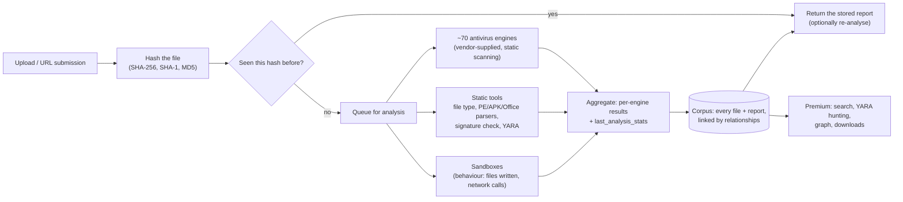

# VirusTotal: how it works, and what PhishShield took from it

Our mentors asked us to study VirusTotal's design. This document covers:

- what the service does;
- how it appears to work behind the scenes, based on its public documentation and API (we have no access to its internals);
- the limits of its free API;
- what we built into PhishShield as a result, and what we deliberately left out.

> **How to read this.** Statements about VirusTotal's internals come from its public API, documentation and blog posts. Where we are inferring something, we say so. Numbers such as engine counts change over time, so treat them as approximate.

---

## 1. What VirusTotal is

VirusTotal (VT) is a **multi-scanner and threat-intelligence aggregator**.

- You give it a file, URL, domain or IP address.
- It reports what dozens of independent security vendors think of it, plus a lot of metadata.

**History.**

- Started in 2004 by Hispasec Sistemas, a Spanish security company.
- Acquired by Google in 2012.
- Now part of Google's security products, alongside Mandiant and Google Threat Intelligence.

**The core idea is consensus.** No single antivirus engine is reliable on its own: each has false positives and blind spots. Showing all of them side by side lets a person judge, for example:

- "40 of 70 engines say this is a trojan" is strong evidence;
- "1 of 70 says it is suspicious" is weak evidence.

---

## 2. How the backend works (as far as the public interfaces show)



### 2.1 Everything is keyed by hash

- When a file arrives, VT computes its **SHA-256** (and SHA-1 and MD5).
- The SHA-256 becomes the file's identity: `GET /api/v3/files/{sha256}` returns the stored report.
- Because of this, *asking about a file never requires sending the file*, as long as someone has uploaded it before.
- It also deduplicates the whole system: a popular malware sample uploaded a million times is analysed once.

### 2.2 Many engines, run by VT

- Antivirus vendors give VT **command-line versions of their engines**, and VT runs them on its own infrastructure.
- VT's documentation states that these are not the full consumer products. They usually lack behavioural protection and cloud features.
- So a VT result is not the same as "would my antivirus have stopped it?"
- Each engine returns a category (`malicious`, `suspicious`, `undetected`, `harmless`, `timeout`, `type-unsupported`, `failure`) and a detection name.
- VT then aggregates these into `last_analysis_stats`:

```json
"last_analysis_stats": { "malicious": 41, "suspicious": 1, "undetected": 22, "harmless": 0, "timeout": 0, "type-unsupported": 8, "failure": 0 }
```

**VT itself does not issue a single "malicious: yes/no" verdict.** Every integration has to pick its own threshold. This is the most important design lesson for us (see §5).

### 2.3 Static analysis tools

Besides antivirus engines, VT runs format-specific analysers. Their outputs appear as report sections:

| Tool category | What it tells you | VT examples |
| --- | --- | --- |
| **File type identification** | What the file really is, from its bytes, not its name | TrID, magic-byte detection |
| **Executable parsers** | Headers, sections, imports, whether it is digitally signed | PE info; `sigcheck` for Authenticode signatures |
| **Android parsers** | Package name, requested permissions, activities | Androguard-style APK analysis |
| **Office/PDF parsers** | Macros, embedded objects, JavaScript, auto-run actions | olevba-style macro extraction, PDF structure |
| **Metadata** | Author, creation tool, timestamps | ExifTool |
| **Pattern rules** | Matches against community and vendor YARA rules | Crowdsourced YARA, Sigma, IDS rules |
| **Contained URLs and IPs** | Links found inside the file | "Contacted URLs" and "embedded URLs" relationships |

### 2.4 Sandboxes (dynamic analysis)

VT also detonates some files in sandboxes, both its own and partners'. A sandbox report records what the program *did*:

- files written;
- registry changes;
- processes started;
- domains contacted;
- network traffic.

This catches malware that looks harmless statically. It is expensive and slow, which is why it only happens on VT's side.

### 2.5 URLs, domains and IPs

**URL identifiers.** VT identifies a URL by an ID: the URL encoded as **unpadded base64url** (or the SHA-256 of the canonical URL). So `GET /api/v3/urls/{id}` asks "has anyone scanned this exact URL?"

**Who checks URLs.** URL verdicts come from about 70+ blocklist and URL-reputation vendors, for example Google Safe Browsing, Fortinet, Kaspersky and many smaller lists.

**Domains and IPs** carry aggregated data:

- WHOIS and registration data;
- DNS records;
- HTTPS certificates;
- related files and URLs.

### 2.6 The relationship graph

Every object links to others, for example:

- this file *contacted* that domain;
- this domain *resolves to* that IP;
- this URL *downloaded* that file.

Investigators use these links ("VT Graph", relationship endpoints) to pivot from one indicator to a whole campaign. This is the premium side of the business.

### 2.7 Community signals

Users can vote (harmless or malicious) and comment, which produces a `reputation` score. This is noisy, but useful as context.

### 2.8 Infrastructure

VT has run on Google's infrastructure since the acquisition. We found no detailed public architecture write-up, so we make no specific claims about databases or services. What is clear from the API design:

- It is **content-addressed**: hashes and IDs are primary keys.
- **Reports are precomputed and cached.** Lookups are cheap; uploads trigger an expensive pipeline.
- **Quotas protect the expensive pipeline.**

---

## 3. The public API (v3)

All requests go to `https://www.virustotal.com/api/v3/` with the header `x-apikey: <key>`.

| Endpoint | Purpose | Used by PhishShield? |
| --- | --- | --- |
| `GET /files/{sha256}` | Report for a known file | **Yes**: file fingerprint lookup |
| `POST /files` (≤32 MB), `GET /files/upload_url` (larger) | Upload a file for scanning | **No**, by design (see §4) |
| `GET /urls/{base64url-id}` | Report for a URL already scanned | **Yes**: manual link scans |
| `POST /urls` | Submit a URL for a new scan | **No**: it makes VT fetch the URL, and costs quota |
| `GET /analyses/{id}` | Poll a running analysis | No |
| `GET /domains/{domain}`, `GET /ip_addresses/{ip}` | Domain or IP report | Not yet |

**Responses** follow JSON:API style: `{ "data": { "id", "type", "attributes": { ... } } }`. The attributes we read are:

- `last_analysis_stats`
- `last_analysis_date`
- `type_description`
- `meaningful_name`
- `popular_threat_classification.suggested_threat_label`
- `reputation`

**Errors** come as JSON with a code, for example:

| Code | HTTP status | Meaning |
| --- | --- | --- |
| `NotFoundError` | 404 | VT has never seen this file or URL |
| `WrongCredentialsError` | 401 | Bad API key |
| `ForbiddenError` | 403 | Key not allowed to do this |
| `QuotaExceededError` | 429 | Quota used up |

### 3.1 Free ("Public API") limits and terms

| | Public API (free) | Premium API |
| --- | --- | --- |
| Rate | **4 requests/minute** | Per contract |
| Daily | **500 requests/day** | Per contract |
| Monthly | ~15.5K requests/month | Per contract |
| Commercial use | **Not allowed** in commercial products or services | Allowed |
| Search, hunting, downloads | No | Yes |

Two more terms:

- Making extra accounts to get around the limits is prohibited.
- Uploaded files are shared with VT's security community and partners. Premium customers can download samples. Keeping uploads private needs the paid Private Scanning product.

**What this means for us:**

1. **4 per minute is far too little for per-page checks.** One person browsing visits dozens of pages a minute. So PhishShield queries VT **only on demand**: manual link scans and file fingerprints.
2. **The free key is for the hackathon demo only.** A commercial product would need a premium licence. We say this in the README and the settings page.

---

## 4. The privacy trap: uploading is publishing

**This is the most important thing we learned.**

- Anything uploaded to VT becomes available to paying VT customers.
- Researchers have repeatedly found confidential documents on VT because someone "just wanted to check" them: contracts, CVs, internal memos.

For a consumer security tool, auto-uploading a user's files would be a serious privacy failure. Most people don't know about this.

**PhishShield therefore never uploads files.** It:

1. reads the file **on the device** (in the Security Center page);
2. computes its SHA-256 there;
3. sends **only the 64-character hash** to the PhishShield server, and only if "File fingerprint lookups" is on;
4. the server asks VT `GET /files/{sha256}`.

**What the hash lookup can and can't reveal:**

- If VT has seen the file, we get the multi-engine verdict.
- If not (a 404), we say exactly that: **"VirusTotal has never seen this file. That is not a clean result."**
- A hash reveals nothing about the file's contents. It only matches files VT already has. A unique private document produces a 404 and leaks nothing.

---

## 5. What PhishShield adopted

| VirusTotal idea | How PhishShield uses it | Code |
| --- | --- | --- |
| **Hash as identity, so you never need to send content** | Files are identified by SHA-256 computed on-device. Only the hash leaves, and only with the setting on. | `src/engine/file.ts` → `sha256Hex`; `src/extension/center/center.ts` |
| **Consensus with an explicit threshold** | A file or URL counts as **confirmed malicious only when at least 3 engines** say `malicious` (`MULTI_ENGINE_CONFIRM = 3`). 1–2 engines is a "minority detection": a moderate signal (weak if only `suspicious`), never confirmation. This mirrors common practice: a single engine's flag is often a false positive. | `src/engine/aggregate.ts` → `minorityDetectionSignal`; `src/server/intel/virustotal.ts` → `detectionsFrom` |
| **"Not found" is not "clean"** | A 404 becomes `no_match` with the message "never seen". The UI says plainly that this is not a clean result. | `virustotal.ts`, `file.ts` → `assessFile` |
| **Show the per-engine breakdown** | The UI shows "41 of 64 engines flagged it", the top threat label and a link to the public VT report. | `src/extension/ui/render-tools.ts` |
| **Static analysers per file type** | Our own on-device inspector, a much smaller version of VT's toolbox (§6). | `src/engine/file.ts` |
| **Embedded URL extraction** | Links inside PDFs and HTML attachments are extracted and run through the URL engine. | `file.ts` → `pdfSignals`, `htmlSignals` |
| **URL ID = unpadded base64url** | Used for `GET /urls/{id}`. | `virustotal.ts` → `vtUrlId` |
| **Quotas protect the expensive path** | A local limiter (4/min, 500/day) stops us from ever hitting VT's 429. VT is marked `onDemand`, so automatic page checks skip it and the UI says "Checked on manual scans only (free-tier quota)". Results are cached. | `virustotal.ts`, `src/server/intel/service.ts` |
| **Lookup, never submit** | No `POST /files`, no `POST /urls`. We never make VT fetch a user's URL. | — |

### 6. Our on-device "mini VirusTotal" (static file inspector)

VT's static tools run on uploaded files. Ours run **in the browser, on the user's machine**, and the file never leaves it. `inspectFile()` in `src/engine/file.ts` does the following.

| Check | VT equivalent | What it catches |
| --- | --- | --- |
| **Magic-byte type detection** (PE, ELF, Mach-O, ZIP, PDF, OLE, RAR, 7z, gzip, LNK, ISO, images, HTML, scripts) | TrID | `statement.pdf` that is really a Windows program: **type mismatch** (strong) |
| **File-name tricks** | — | Right-to-left override (`invoice[U+202E]fdp.exe` displays as `invoiceexe.pdf`), double extensions (`Bill.pdf.exe`), names padded with spaces |
| **ZIP reader** (central directory, ZIP64, encryption flag; inflates single entries with the browser's `DecompressionStream`) | Archive unpacking | Programs inside archives, **password-protected archives hiding programs** (a classic way to dodge e-mail scanners) |
| **APK permission reader** (reads `AndroidManifest.xml` from the APK zip) | Androguard | Scam APKs that ask for `RECEIVE_SMS`, `READ_SMS`, `BIND_ACCESSIBILITY_SERVICE`, `BIND_NOTIFICATION_LISTENER_SERVICE`, `REQUEST_INSTALL_PACKAGES`, `SYSTEM_ALERT_WINDOW`… which is how fake "KYC update" and "e-challan" apps steal OTPs |
| **APK lure names** | — | `SBI_YONO_KYC_Update.apk`, `RTO_E-Challan.apk`, `Wedding_Invitation.apk` |
| **Office macro detection** (`vbaProject.bin` in OOXML, macro-enabled extensions) | olevba | `.docm` / `.xlsm` "salary revision" documents |
| **PDF internals** (`/OpenAction`, `/JS`, `/Launch`, `/EmbeddedFile`, `/URI`) | PDF parsers | PDFs that run JavaScript on open, launch programs, or carry hidden files |
| **HTML attachment checks** | — | Saved login pages (password field in a local `.html`), **HTML smuggling** (Blob + base64 + `createObjectURL`) |
| **Authenticode presence** (PE data directory #4) | sigcheck | Shown as information only. A signature is *not* proof of safety, and we say so. |

Every finding becomes a normal PhishShield **signal**: id, weight, strength, explanation and evidence. So files get the same verdicts, scores and "why" explanations as web pages.

**Limits we state in the UI:**

- static only, never executed;
- 256 MB inspection cap;
- no emulation or sandbox;
- encrypted archives can't be looked into;
- "a clean result is not proof the file is safe".

---

## 7. What we deliberately did not copy

| VT feature | Why not |
| --- | --- |
| Uploading files | Privacy (§4), and the free API's terms. |
| Running ~70 engines | Needs vendor licences and a data centre. We use VT's results instead of re-creating them. |
| Sandboxing | Executing untrusted files is explicitly out of scope ("never execute downloaded or uploaded files"). |
| Submitting URLs for scanning | It makes a third party fetch a URL the user visited, and each scan costs quota. |
| Community votes | Easy to game, and needs accounts, which we avoid. |

---

## 8. Ideas for later

- **Domain and IP reports** (`/domains/{d}`) for manual scans: categories, registrar, `last_analysis_stats` from URL vendors.
- **Behaviour summaries** (`/files/{id}/behaviour_summary`) when a hash is known, to show "this file tried to contact X".
- **Premium API**, if PhishShield ever becomes a commercial product (required by VT's terms).

## Sources

- VirusTotal API v3 reference: https://docs.virustotal.com/reference/overview
- Public vs Premium API comparison: https://docs.virustotal.com/reference/public-vs-premium-api
- Integrator documentation repeating the limits and non-commercial terms: [D3 Security: VirusTotal v3](https://docs.d3security.com/integration-docs/latest-version/virustotal-v3), [themains/virustotal (GitHub)](https://github.com/themains/virustotal)
- Note on uploaded files being shared with partners: [issoh.co.jp](https://www.issoh.co.jp/tech/details/17462/)
